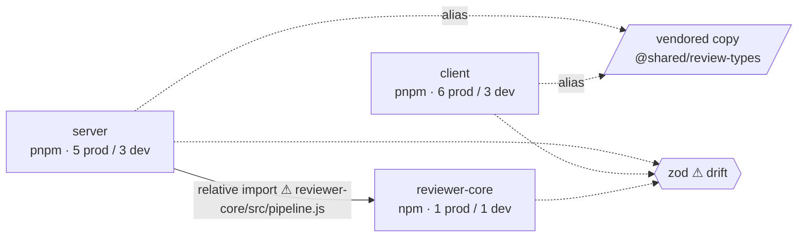

# Report template

`render.mjs` produces this layout from a scan. Use it by hand when the data was given to you
in the prompt and no scan is possible. Keep the five numbered sections and their names: the
reader (and the evals) look for them.

````markdown
# Dependency Report — <repo>

<two or three sentences: size of the estate, the one structural fact behind most findings, what to do first>

## 1. Scope

Repository layout: **<independent packages | pnpm workspace | npm workspaces>**. Package managers: **<pnpm, npm>**.

| Package | Path | Manager | Lockfile | Prod deps | Dev deps | node_modules | Source files |
| --- | --- | --- | --- | --- | --- | --- | --- |
| `server` | `server` | pnpm | pnpm-lock.yaml | 5 | 3 | 24.7 MB | – |

Ignored: <folders>. Not measured: <anything missing from the data and why>.

**Internal vs external.** External dependencies are npm packages. Internal dependencies are links between this repository's own packages (tsconfig path aliases, `workspace:`/`file:` deps, relative imports across a package boundary, vendored copies). They follow different rules and are reported separately.

## 2. Dependency Graph

### 2.1 Packages and internal links



| From | Kind | To | Via | Target |
| --- | --- | --- | --- | --- |
| `server` | relative-import | `reviewer-core` | `reviewer-core/src/pipeline.js` | bypasses the public entry |

### 2.2 Components inside each package

<one `flowchart TD` per package when the data shows internal modules; otherwise one line saying no component data was available>

## 3. Sizes

<the overlap caveat in one sentence>

### 3.1 Footprint per package
| Package | node_modules | Heaviest runtime dep | Heaviest dev dep |

### 3.2 Heaviest dependencies
<ranked list or `xychart-beta` bar chart>

### 3.3 Every declared dependency
| Dependency | Package | Type | Category | Declared | Installed | Own | Transitive | License | Used by |

### 3.4 Duplicate versions
| Dependency | Versions | Where | Wasted |

## 4. Findings & Priorities

### 🔴 P0
- **CODE** · `package` › `subject` — evidence. → action. _confidence: high_

### 🟠 P1
### 🟡 P2
### 🔵 Info

## 5. Summary

1. **[P0] …** — what › do this → because.
2. …
(3 to 5 items, priority order, every one names a package / dependency / file)

## Appendix
A. shared external dependencies across packages · B. vendored copies · C. method and limits
````

Conventions:

- Node ids in Mermaid must be plain identifiers; put the readable name in the `["…"]` label.
- One ` ```mermaid ` block per diagram; the first line is `flowchart LR` (packages) or
  `flowchart TD` (components).
- Findings use the exact line shape from
  [severity-rubric.md](severity-rubric.md#writing-a-finding).
- Recommendations are phrased for the user to confirm, never as completed actions.
