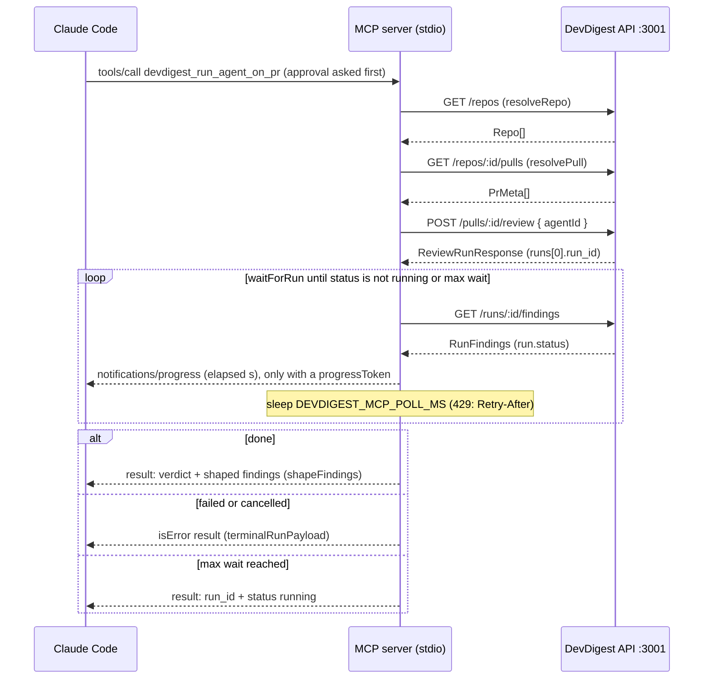
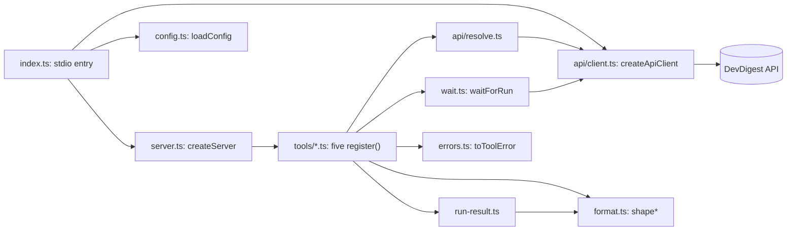

# Architecture of `@devdigest/mcp`

How the MCP package is put together and why. The behavioural contract (tools,
run-and-wait, resolution, errors, config) lives in
[`../specs/mcp-server.md`](../specs/mcp-server.md); this file is about the
shape of the code and two decisions. Paths are relative to `mcp/` unless they
start with `server/`.

## One call, end to end

`devdigest_run_agent_on_pr` from Claude Code. Every arrow maps to a symbol or
route: `resolveRepo` and `resolvePull` (`src/api/resolve.ts`), `waitForRun`
(`src/wait.ts`), `terminalRunPayload` (`src/run-result.ts`).

## Modules

`index.ts` loads config, builds the API client around `globalThis.fetch`,
creates the server and connects a `StdioServerTransport`. Tools receive
`{ api, config, sleep, now }` (`tools/types.ts`), so tests inject a fake fetch,
a fake clock and an in-memory MCP client with no network.

## Decisions

### A separate package that is an HTTP client of the API

`mcp/` has its own `package.json` and lockfile and talks to the running API
over HTTP. It does not import server modules, open the database, or call
GitHub. The server's onion rings (`routes -> service -> repository`) stay
untouched: the only server change is one ordinary read route,
`GET /runs/:id/findings`, added through the usual trio.

Why: the API already holds workspace scoping, secrets and rate limits, and a
second path to the DB would bypass them. The MCP SDK's dependency tree also
stays out of the server and client packages. Rejected: embedding the MCP
server in the Fastify app (puts a stdio transport and its stdout rules inside
the API process), and having the MCP package read Postgres directly
(duplicates scoping, needs DB credentials).

### Type-only `@devdigest/shared` imports

The tsconfig path alias `@devdigest/shared` points at
`server/src/vendor/shared/index.ts`, and the package imports it with
`import type` only (lint-enforced). Contract types are shared without any
runtime import.

Why: a runtime import would execute the shared Zod schemas from
`server/node_modules`, loading a second zod copy beside the one the MCP SDK
uses for tool input schemas; schemas from two instances do not interoperate.
The tsconfig maps only `zod` to `./node_modules/zod`, not `zod/*`: mapping
`zod/*` made `registerTool` typing fail with TS2589 and exhaust the heap.
Rejected: vendoring a copy of the contracts into `mcp/` (a third copy to keep
in sync).

## Why polling

`POST /pulls/:id/review` returns run ids and does not wait, and
`GET /runs/:id/trace` carries the trace, not the verdict. The MCP server polls
`GET /runs/:id/findings`, which returns run status, review verdict and
findings in one call. Polling is also what lets the tool return `running` plus
a `run_id` when the wait limit is hit, so a long review never blocks the
client past its tool timeout (`.mcp.json` `timeout` 660000, max wait capped at
600000 ms).
