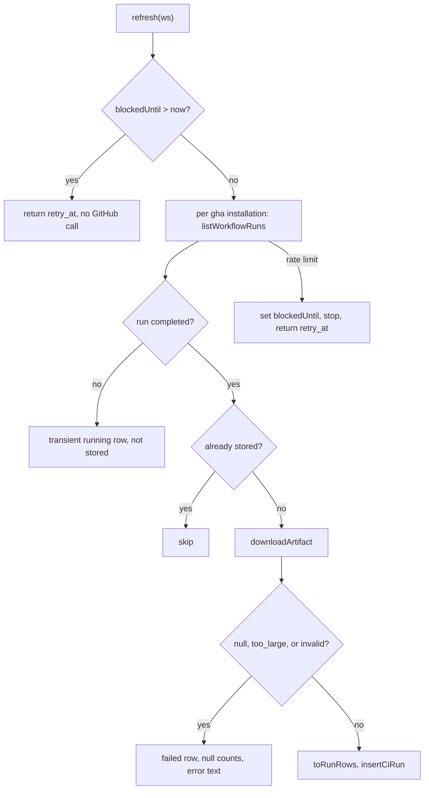
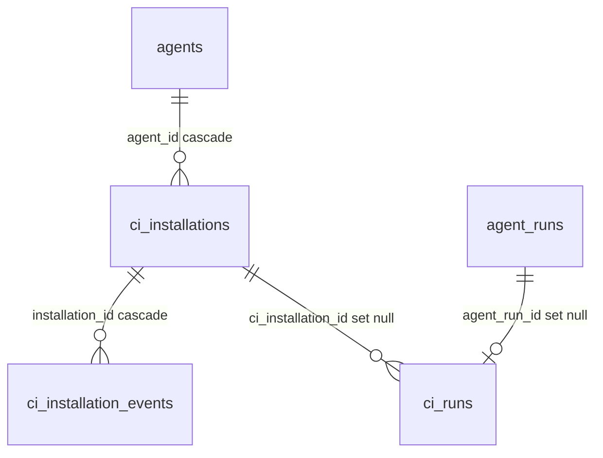

# Export to CI — how it works and why

The behavioural contract (routes, tables, files, invariants) is
[`../specs/export-to-ci.md`](../specs/export-to-ci.md); the UI is
[`../../client/specs/export-to-ci.md`](../../client/specs/export-to-ci.md); the
runner is [`../../agent-runner/README.md`](../../agent-runner/README.md). This
note explains the end-to-end flow and the decisions behind it.

## End to end

The studio never receives a pushed result. It writes files to GitHub, and later
reads what the workflow left behind.

```mermaid
sequenceDiagram
  participant UI as ExportCiWizard / CI Runs
  participant R as ci/routes.ts
  participant S as CiService · CiRunsService
  participant GH as GitHubClient (octokit.ts)
  participant WF as GitHub Actions run
  participant RN as agent-runner (dist/index.js)
  participant DB as ci_* · agent_runs

  UI->>R: POST /agents/:id/ci/preview
  R->>S: preview (buildFiles, workflow_state probe, 1.5 s)
  UI->>R: POST /agents/:id/export-ci
  S->>GH: getRepoInfo · commitFiles(branch devdigest/ci, base default)
  S->>GH: findOpenPr or openPullRequest
  S->>DB: upsert ci_installations + install event
  Note over GH,WF: a human merges the PR; a PR event starts the workflow
  WF->>RN: node .devdigest/runner/index.js
  RN->>GH: read PR + diff, post review or comment
  RN->>WF: write devdigest-result.json, upload artifact devdigest-result
  UI->>R: POST /ci/runs/refresh (button or 60 s while visible)
  R->>S: CiRunsService.refresh
  S->>GH: listWorkflowRuns (50) · downloadArtifact (size check, redirect w/o Authorization)
  S->>S: parseArtifact (1 MB inflated cap, CiResultArtifact)
  S->>DB: insertCiRun: agent_runs (source ci, pr_id null) + ci_runs, one transaction
  UI->>R: GET /ci/runs (stored rows)
```

Ingest as a pipeline:



Tables:



## Decisions

- **Pull, not push.** The runner has no studio URL and the studio is local, so results travel as a workflow artifact and the studio reads it through the GitHub API. This removes any endpoint that accepts results, which is the main attack surface a local-first tool would otherwise gain.
- **One branch, one commit.** Every write goes to `devdigest/ci` through one atomic `commitFiles`; the default branch is read live (`getRepoInfo`) because `repos.default_branch` can be stale. An open PR from that branch is reused, so a double click opens one PR.
- **Pre-computed hash for "out of date".** `ci_installations.config_hash` is a sha256 over the non-editable files plus the template version. The editable workflow is excluded, so a human edit never marks an installation out of date, while a change of `ci_fail_on`, prompt, skills, memory or the runner bundle does.
- **Artifact is data from an untrusted job.** A forked or edited workflow can upload anything. Sizes are checked before and during download, the inflated bytes are counted while unzipping (zip headers can lie), every number has a bound, and the job URL is taken from the API. The UI labels findings and cost "Reported by the CI job, not verified".
- **No studio model call.** Verdict and blockers come from the artifact; `modules/ci` may not import `reviewer-core`. Only `agent-runner/` does.
- **CI rows in `agent_runs` with `pr_id` null.** That keeps them out of the per-PR readers while the agent card stats still include them.
- **A module-local repository getter.** `routes-no-persistence` forbids a route from importing a repository, so `Container.ciRepo` (mirroring `prBriefRepo`) is the one `platform/container.ts` change.
- **Runner bundle committed.** `agent-runner/dist/index.js` is committed and read by `platform/runner-bundle.ts`, so the studio needs no build step and no env variable. `agent-runner/test/bundle.test.ts` fails when the bundle is stale.
- **Rejected:** a GitHub App (the spec's non-goal; a PAT in the studio is enough); a published action (`devdigest/review-action`; the files are copied into the repo instead); detecting a workflow removed by hand.
- **Known limit.** `REQUEST_CHANGES` posted with `GITHUB_TOKEN` is not documented by GitHub; the runner falls back to a `COMMENT` review, then to a PR comment, and the exit code stays the gate.
