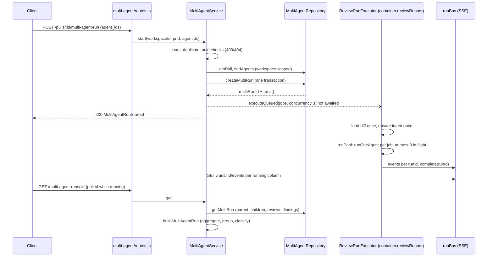
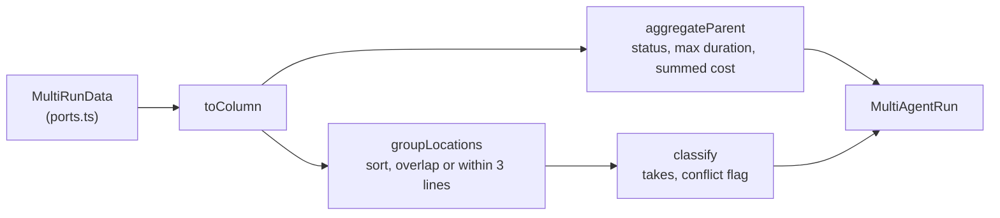

# Multi-Agent Review: how it works and why

Contract: [`../specs/multi-agent-review.md`](../specs/multi-agent-review.md)
(UI half: `client/specs/multi-agent-review.md`). Paths are relative to
`server/src/`.

## Start and run

## Read model

## Decisions

- **A new module reaches the executor through the container.** The module
  `no-cross-module` rule forbids importing `reviews/run-executor.ts`.
  `multi-agent/ports.ts` declares a structural `ReviewRunnerPort`;
  `routes.ts` passes `container.reviewRunner`, a singleton
  `ReviewRunExecutor` that `platform/container.ts` builds beside
  `intentService` and `multiAgentRepo`. `reviews/routes.ts` now uses
  `container.intentService` instead of building its own copy, so the intent
  dependencies are composed once. The executor has two owners (`ReviewService`
  and the container) and holds no per-request state, so this is safe.
- **Child runs are plain `agent_runs`.** Rows are created up front, so the
  response is fast and every existing run route works on a child. The alternative
  of a separate table for child runs was not taken; only `multi_run_id` was
  added.
- **Concurrency by a pool, default 1.** `executeRuns` takes
  `opts.concurrency`, default 1, so `POST /pulls/:id/review` keeps its sequential,
  target-order behaviour. `runPool` never rejects, so one failing agent does not
  stop the rest. Three is a constant (`MULTI_AGENT_CONCURRENCY`), exposed to the
  client in the estimates response.
- **The 400 rule lives in the service.** Route-schema failures map to 422
  (`app.ts` error handler), so the 2 to 8 count and the duplicate check throw
  `AppError(…, 400)` in `start`. The route schema only fixes the shape.
- **Everything derived is computed on read.** Parent status, totals, groups and
  conflicts come from the child rows each time. Nothing can go stale, and a
  restart that reaps running children needs no repair of the parent.
- **Grouping is a rule, not a model.** Same file, overlapping range or starts
  within three lines. The sort order is fixed so the output is deterministic.
  A model-written "why silent" note was rejected (a non-goal of the spec).
- **`no_result` is separate from `ignored`.** An agent that failed, was cancelled
  or is still running cannot be said to have missed a finding, so it never makes
  a location a conflict.
- **The cancel race is fixed in the executor.** `RunBus.complete` clears the
  cancel flag right after `cancelRun` sets it, so `checkCancelled` used to see
  nothing and a late success overwrote `cancelled` with `done`. Now `isComplete`
  counts as cancelled and queued runs are skipped. The fix applies to
  `/review` runs too.
- **Estimates come from one windowed query.** `row_number() over (partition by
  agent_id order by ran_at desc)` keeps the latest 10 done review runs per agent;
  brief runs are excluded by `kind = 'review'`.
