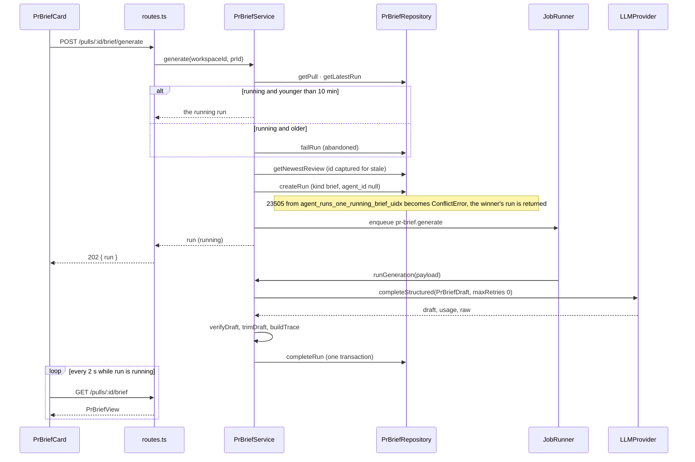
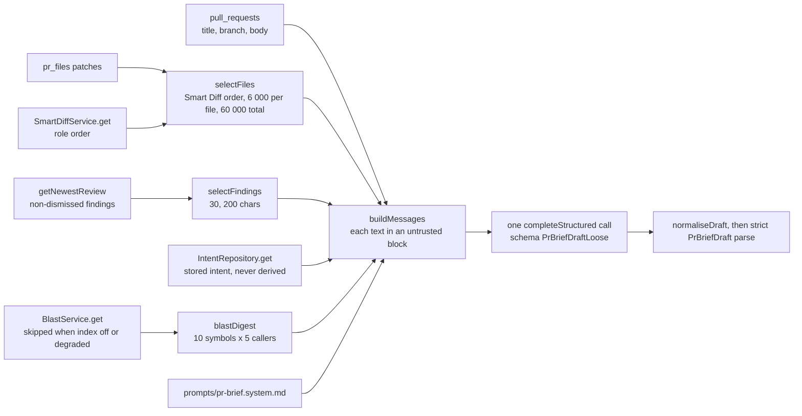
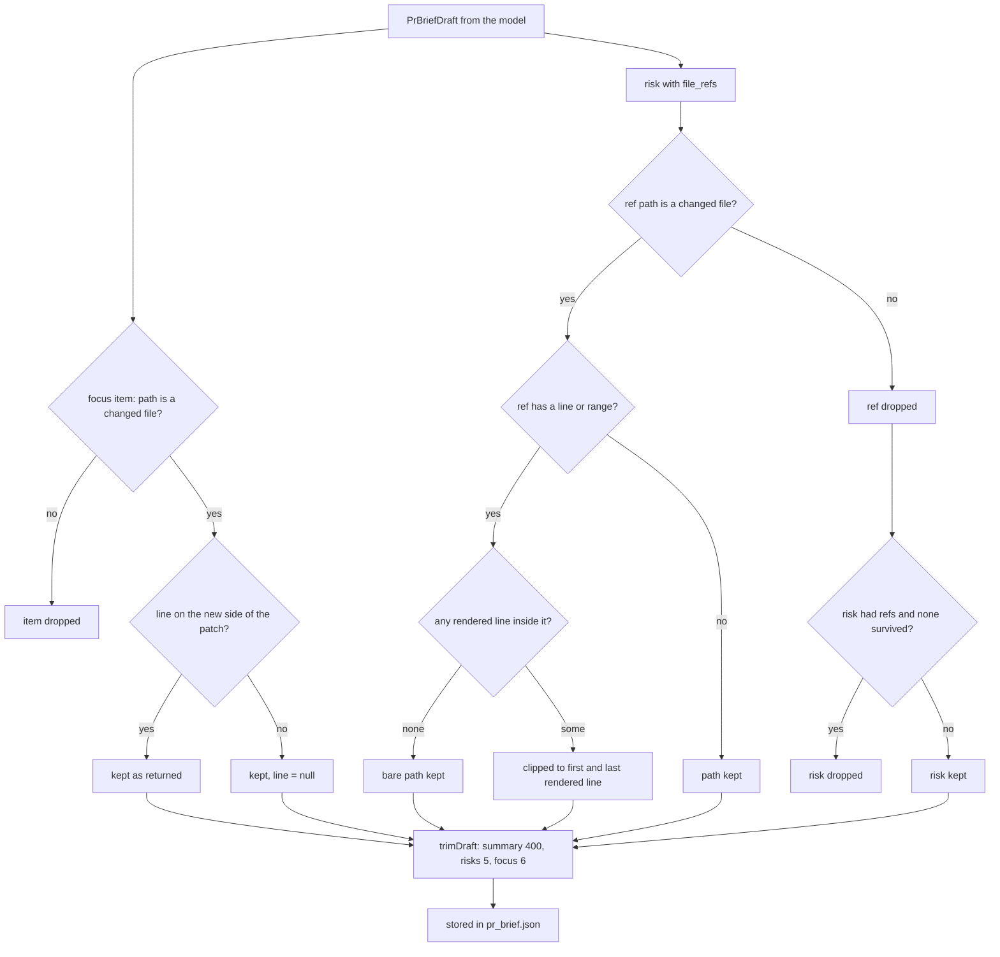

# PR Brief — how it works and why

The behavioural contract (routes, tables, caps, trace shape, invariants) is
[`../specs/pr-brief.md`](../specs/pr-brief.md); the UI is
[`../../client/specs/pr-brief.md`](../../client/specs/pr-brief.md). This note
explains the flows and the decisions behind them.

## Generate flow

`POST /pulls/:id/brief/generate` answers `202` with a running run and does the
work in a background job. The client polls `GET /pulls/:id/brief` until the run
settles.

The handler never throws. On any error it calls `failRun` (status, error text,
usage) and `saveTrace`, so the run row and its trace say what happened; the
stored brief is left alone.

## Data flow of the inputs

Everything the model sees is chosen in code before the call. Nothing in this
step calls a model.

The findings are an input, but the card's verdict, score, findings count and
blockers are not stored with the brief: `view` reads them from the newest review
at request time (`getNewestReview`), so a dismissed finding changes the card
without a new call.

## Verification of references

The model returns paths and line numbers it cannot be trusted with. Before
storing, `verifyDraft` checks each one against the persisted patches.

`newSideLines` parses the unified patch and counts new-side lines the same way
the client diff viewer does (`components/diff-viewer/helpers.ts`), so a verified
line is a line the Files changed tab renders and can scroll to.

## Decisions and rejected alternatives

- **Brief runs are `agent_runs` rows with a `kind` column.** A brief then gets a
  run id, a trace, SSE log lines, usage and a price-book cost with no new
  machinery, and the cost line on the card opens the existing run drawer.
  Rejected: a separate table of brief runs (a second trace and cost path), and
  storing only cost on `pr_brief` (no audit trail, no failure record). The price
  of reuse is the `kind = 'review'` filter in the three readers that must not show
  a brief; the cost rollup deliberately keeps them.
- **The brief and the run are written in one transaction.** `completeRun`
  upserts `pr_brief`, finishes the run and stores the trace together, so a reader
  that sees `done` always finds the brief, and a failed run cannot half-replace a
  brief.
- **`pr_brief.run_id` is not a foreign key.** Deleting a run must not delete the
  brief that is still shown; the card falls back to the latest run id when it is
  null.
- **`agent_runs.pr_id` stays `ON DELETE SET NULL`.** A deleted PR cascades the
  brief away and leaves the run row, marked failed by the job. Rejected: changing
  the delete rule of a pre-existing column for one feature (found by the
  cross-model review, see the spec).
- **No `reviewer-core` change.** The `pr-brief` module may not import
  `reviewer-core` (`.dependency-cruiser.cjs`), so the hunk parser, the untrusted
  wrapper and the message builder are pure functions in `pr-brief/helpers.ts`.
  Cost: a second copy of the hunk-counting logic next to the client's.
- **Diff from `pr_files`, not git.** The Files changed tab renders the same
  patches, so verification and the deep link agree. The read makes no git call.
  `pr_files` exists once `GET /pulls/:id` has run, which the PR page does before
  offering Generate; an empty file list still produces a brief from title, body
  and findings.
- **Loose schema to the model, strict schema in storage.** Two live runs on
  2026-10-21 showed that a strict enum or integer in the model schema fails the
  whole run over a cased `kind` or a stringly `line`, and one failure recorded no
  reason. The call now uses `PrBriefDraftLoose` and `normaliseDraft` maps it
  (unknown `kind` → `other`, unknown `severity` → `medium`, non-numeric `line` →
  null) before the strict `PrBriefDraft` parse. Rejected: a reprompt on schema
  failure (a second call, breaks the one-call rule). An invalid output now says
  why: the run error is `The model returned an invalid brief: <parse issues>`
  (issues appended by the OpenRouter adapter, capped at 400 characters, never raw
  text) and is also one `error` log line in the trace.
- **A deadline outside the adapter.** OpenRouter ignores `timeoutMs`, and the
  120 s job timeout does not cancel the handler, so the service wraps the call in
  `withTimeout` (90 s). The HTTP request may keep running in the background; its
  late result is discarded.
- **One call means no reprompt, not no retry.** `maxRetries: 0` turns off the
  structured-output reprompt loop. A transport retry after a 429 or 5xx is the
  same request resent, is left to the adapter, and can be billed again.
- **Stale is computed, never stored.** Comparing `head_sha` and the newest review
  id at view time needs no invalidation when a review lands or a commit arrives.
  A model change, a dismiss or an accept deliberately does not count.
- **Dependencies by structural ports.** Intent, Smart Diff and blast are reached
  through `IntentReader`, `SmartDiffReader` and `BlastReader` (`ports.ts`),
  backed by new container getters `smartDiffService` and `blastService` and the
  existing `intentRepo`; the module never imports a sibling module.
  `prBriefRepo` is overridable in `ContainerOverrides`.

## Known limits

- `GET /runs/:id/trace` is not workspace-scoped; brief traces inherit that.
- The generation deadline does not abort the provider request.
- `statsByAgent` has the `kind` filter but no test asserts it.
