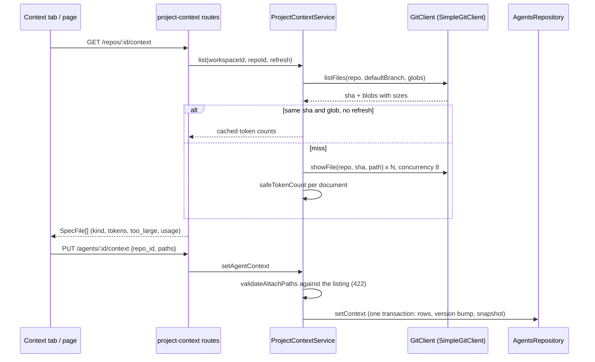
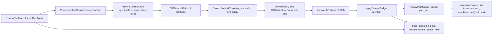
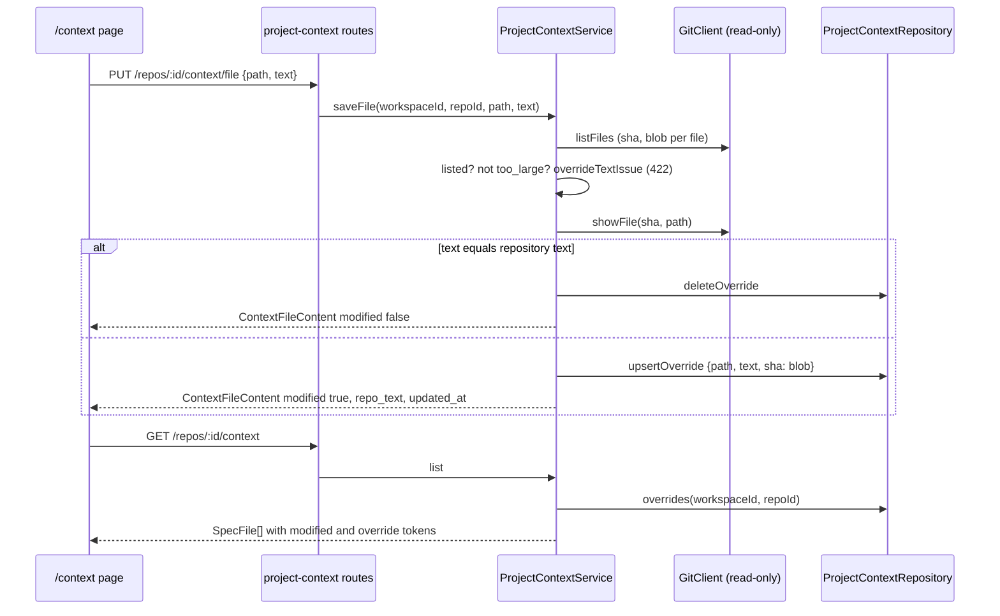

# Project context: how it works and why

Behavioural contract: [`../specs/project-context.md`](../specs/project-context.md)
(UI half: [`client/specs/project-context.md`](../../client/specs/project-context.md)).
This note explains the moving parts and the decisions behind them.

## The two flows

An attachment is a path in a link table. The text is not stored with it: it is
read from git when a page needs it and again when a run starts (unless a local
override exists, see below).

At run start the executor resolves the same links against the PR's base branch:

## Local overrides

A document can be edited on the page. The edit is a row in
`context_doc_overrides`, keyed (repository, path); git, the clone and GitHub are
never written. Reads and runs take the row in place of the repository text.

At run start `resolveForRun` reads the overrides of the resolved paths with one
query and uses the text of a hit instead of `showFile`; everything after that
(cut at 8,000 tokens, 24,000-token budget, `wrapUntrusted`, trace) is the path
repository text takes. The trace block carries `modified: true`.

## Decisions

**Read from the object database, never the working tree.** `listFiles` and
`showFile` resolve a branch to a commit sha and read blobs from it. The working
tree of a clone can be dirty or traversed with `..`; a sha cannot. This is the
same reason `showFile` exists next to `readFile` (see `INSIGHTS.md`).

**Documents come from the PR's base branch.** A run reads the rules as they are
on the branch the PR targets. If it read the head, a PR could edit an attached
spec and be judged by its own edit. Consequence: a PR that edits an attached
spec shows the base text in the drawer. The clone is depth 1 and single branch,
so the base is usable only when it is the branch the clone holds; otherwise the
context is skipped with a logged reason per path rather than fetching another
branch.

**The adapter matches globs; the module expands braces.** The plan was to hand
git `:(glob)` pathspecs. `git ls-tree` rejects pathspec magic, so
`SimpleGitClient.listFiles` lists every blob once and filters with its own
`globToRegExp`. Git globs have no braces either, so the module expands
`{specs,docs,insights}` (`expandBraces`, `globToPathspecs`) and passes plain
globs. The adapter stays generic (a ref and globs); discovery rules such as
`node_modules` and dot-folder exclusion live in the module (`isExcludedPath`),
because adapters may not import modules.

**The service is a container-owned singleton.** `Container.projectContext`
builds one `ProjectContextService` for the process because it holds the
listing cache (latest listing per repo, keyed `repoId:sha:glob`, token counts
only). A service built per request would lose the cache. Routes and the run
executor therefore both take the same instance from the container, and route
tests inject one built from in-memory fakes (`ContainerOverrides.projectContext`). Memory is bounded by keeping one entry per repo.
The cache is per API process.

**Listing always asks git for the sha, caches only the blob reads.**
`listFiles` is cheap (one `rev-parse`, one `ls-tree`), and it tells whether the
branch moved. The expensive part, one `showFile` per file to count tokens, is
what the cache saves. `?refresh=true` skips the cache and is rate limited.

**Token counting is capped against hostile text.** The tokenizer is quadratic
on a long run without whitespace, so a 200 KB single-line file could stall the
event loop on listing or truncation. `safeTokenCount` counts such text as
`ceil(length / 4)` and the service routes every count through it. The count is
labelled approximate in the UI anyway.

**Two caps, two scopes.** 8,000 tokens bound one document; 24,000 bound the
summed documents of one assembled prompt. In a map-reduce run the context is
repeated in every chunk prompt (as skill blocks are), so the cap applies per
chunk, not per run; resolution and budgeting still run once per agent run.

**Agent links in `AgentsRepository`, skill links in the module.** Changing an
agent's attachments bumps `agents.version` and snapshots the config, which must
share one transaction with the row replace, exactly like `setSkills`. A skill
has no context in its version, so its link writes sit in
`ProjectContextRepository` with no bump. The snapshot's `context` holds all repos
so a version replays completely.

**The injection guard names documents only when they are attached.** Documents
are untrusted: wrapped by `wrapUntrusted(path, text)` with `</untrusted>`
rewritten in the body. `INJECTION_GUARD` is unchanged unless `specs` is
non-empty; then its list of untrusted content also reads "attached project
documents under ## Project context". The condition keeps the prompt of an agent
without attachments byte-identical to the one before the feature. `wrapUntrusted`
also escapes `& " < >` and line breaks in the label, because the label is now a
file path. Keyword scanning of document text was not added (the guard is the
defence).

**Overrides live in the DB, next to the listing cache, never in it.** The cache
is keyed by head sha and holds the repository's token counts; an override
changes without the sha moving, so merging it into the cache would show stale
state after a save. `list` therefore re-reads the overrides on every call (one
indexed query) and swaps in `modified` and the override's token count. Counting
a 200,000-character override on every listing would be wasteful, so
`overrideTokens` memoises the count per (repository, path) together with the
`updatedAt` it was computed for; a new save changes `updatedAt` and recounts,
and the entry is replaced rather than a new key added, which keeps the map
bounded by the number of overridden documents.

**An override is per (repository, path), not per agent.** The same text reaches
every agent and skill that attaches the path, matching how attachment already
works (paths, not copies). A per-agent copy was not built: it would need its
own versioning and a choice of which copy a skill's agents see.

**The service stays read-only toward git.** Saving needs the repository text
(to detect an identical edit) and the blob sha, both from `listFiles` and
`showFile`; the deps type is still `Pick<GitClient, 'listFiles' | 'showFile'>`,
so the code cannot write to the clone. `listFiles` returns the blob sha per file
(from `ls-tree`) instead of a second `rev-parse` per save.

**Identical text, an empty text and a stale base.** Text equal to the
repository text is not stored (an existing override is removed): "modified"
always means "different from the repository". Empty text is rejected with a
pointer to Reset, which is the way back. The stored `sha` records which
repository version the edit was based on, but a later commit does not
invalidate it: the override keeps winning and no warning is shown (a
`base_changed` flag was left out).

**Resetting a path that is not listed or is too large fails.** `resetFile`
follows the listing: an unlisted path answers 404 and a `too_large` one 422,
and in both cases the stored row stays. The alternative, deleting the row and
then failing to read the repository text back, would lose the override on an
error answer.

**Context never fails a run.** Everything in `resolveForRun` is a log line
(`Context skipped: <path> - <reason>`), the executor catches a throw from the
port, and it logs with `runLog.info`, not `runLog.step` (a throw from `step`
shows a toast).

## Known limits

See "Known limits" in the spec: depth-1 base branch, a default branch missing
from the clone (502 `listFiles: ref not found`), the untested refresh rate
limit, two git spawns per file on a cold listing.
